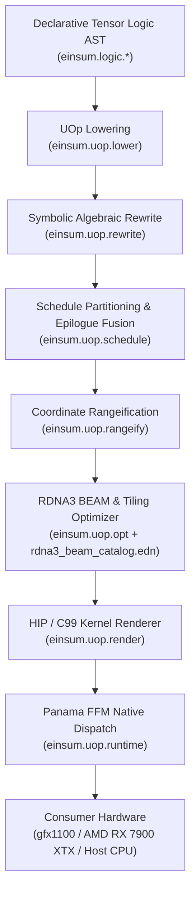

# Pure-Clojure UOp Deep Learning Compiler & Runtime Architecture

`clj-einsum` compiles Pedro Domingos' Declarative Tensor Logic (`einsum.logic.*`) directly to consumer hardware (`gfx1100` / AMD Radeon RX 7900 XTX 24 GB and x86_64 CPU) via a pure-Clojure Micro-Operation (UOp) Intermediate Representation (`einsum.uop.*`).

The entire compilation stack—from symbolic logic lowering and algebraic rewrite to schedule partitioning, 2D cooperative LDS/WMMA tiling optimization, C99/HIP kernel code generation, and off-heap execution via Project Panama FFM (`java.lang.foreign` to `libamdhip64.so` / `libhiprtc.so`)—is implemented exclusively in pure Clojure with zero C++ glue libraries, zero Python, and zero external ML compilers.

---

## 1. End-to-End Compilation Pipeline

The UOp compiler is structured as a pipeline of pure Clojure functions transforming persistent data structures from high-level relational tensor logic expressions into executable native GPU binaries:



### Pipeline Stages

1. **Declarative Tensor Logic (`einsum.logic.*`)**: High-level Homoiconic Hiccup ASTs (`[:= head & body-terms]`) specifying relational Einsum contractions, RMSNorm, RoPE embeddings, gated activations, and attention graphs.
2. **UOp Lowering (`einsum.uop.lower`)**: Lowers relational tensor logic into a canonical, hash-consed UOp Directed Acyclic Graph (DAG) with explicit movement ops (`:uop/reshape`, `:uop/permute`), arithmetic ALU operations, and reductions (`:uop/reduce-axis`).
3. **Symbolic Algebraic Rewrite (`einsum.uop.rewrite`)**: Iteratively canonicalizes and simplifies the UOp DAG using pattern-matching rewrite rules. Simplifies identities, fuses consecutive view operations, pushes movement ops toward memory leaves, and enforces Rule 8 to preserve squeeze reshapes before channel-splitting projections.
4. **Schedule Partitioning & Epilogue Fusion (`einsum.uop.schedule`)**: Identifies realization boundaries to break the full computation graph into discrete kernel dispatches. Peers through view chains via `effective-consumer-count`, realizes non-foldable dependencies (`:uop/cat`, `:uop/dynamic-update-slice`), and folds reconvergent epilogue subgraphs (`:act :gelu`, `:silu`, `:softcap`) into parent reduction kernels.
5. **Coordinate Rangeification (`einsum.uop.rangeify`)**: Converts symbolic dimensional tensors into index coordinate functions and closed-form loop iteration spaces (`:uop/range`). Computes memory strides, ring modulo buffer offsets, and buffer access indices.
6. **RDNA3 BEAM & Tiling Optimizer (`einsum.uop.opt` + `resources/uop/rdna3_beam_catalog.edn`)**: Matches kernels against optimized tile templates for the AMD RDNA3 architecture (`gfx1100`). Selects cooperative LDS block dimensions, strip-minimizing $M$-tiling parameters ($TM \in \{1..8\}$), 4-way $N$-tiling ($TN=4$), and Wave32 BF16 WMMA tensor core tile mappings.
7. **HIP / C99 Kernel Renderer (`einsum.uop.render`)**: Renders AST schedules directly into string representations of C99 and AMD HIP C++ source code. Emits vectorized loads (`float4`, `float8`), bank-conflict-free LDS memory declarations (`stride-18`), unrolled FMAs, hoisted invariant calculations, and native RDNA3 WMMA intrinsics (`__builtin_amdgcn_wmma_f32_16x16x16_bf16_w32`).
8. **Panama FFM Native Dispatch (`einsum.uop.runtime`)**: Compiles HIP code in-process using `libhiprtc.so`, caches `.hsaco` binaries on disk indexed by SHA-256 hash, allocates device buffers via `libamdhip64.so`, and executes kernels via a zero-allocation `slot-ptrs` launch loop.

---

## 2. Hash-Consed UOp IR (`einsum.uop.core` & `einsum.uop.rewrite`)

The intermediate representation is an immutable, hash-consed Clojure map representing pure micro-operations. Every UOp node contains:
- `:op`: Keyword identifying the micro-operation (e.g., `:uop/const`, `:uop/buffer`, `:uop/alu`, `:uop/reduce-axis`, `:uop/reshape`, `:uop/unpack-int4`).
- `:dtype`: Tensor element data type (`:f32`, `:bf16`, `:f16`, `:i32`, `:i8`, `:bool`).
- `:shape`: Vector of dimension sizes or symbolic shapes (e.g., `[1 16 2048]`).
- `:src`: Vector of source input UOp nodes.
- `:arg`: Operator-specific configuration payload (e.g., permutation vector, reduction axes, ALU operator keyword).

### Micro-Operation Classes

```
                          ┌──────────────────────────┐
                          │         UOp IR           │
                          └─────────────┬────────────┘
         ┌───────────────────┬──────────┴───────────┬───────────────────┐
         ▼                   ▼                      ▼                   ▼
   [Movement Ops]       [Compute ALU]        [Reduction Ops]     [Quantization Ops]
   :uop/reshape         :uop/alu             :uop/reduce-axis    :uop/unpack-int4
   :uop/permute         :uop/const           :uop/range          :uop/unpack-ternary
   :uop/expand          :uop/load
   :uop/pad             :uop/store
   :uop/shrink
   :uop/flip
```

1. **Movement Operations**:
   Represent zero-copy coordinate views and layout permutations:
   - `:uop/reshape`: Changes tensor shape while preserving total element count.
   - `:uop/permute`: Reorders dimensions according to an axis permutation vector (e.g., `[0 2 1 3]`).
   - `:uop/expand`: Broadcasts singleton dimensions to match target dimensions without allocating memory.
   - `:uop/pad`: Surrounds bounds with zero-padding (useful for convolution and tiled alignments).
   - `:uop/shrink`: Slices contiguous ranges along coordinate axes.
   - `:uop/flip`: Reverses dimension indexing.

2. **Compute & ALU Operations**:
   - `:uop/alu`: Elementwise mathematical operations (`:add`, `:sub`, `:mul`, `:div`, `:fma`, `:exp2`, `:log2`, `:sin`, `:cos`, `:sqrt`, `:rsqrt`, `:maximum`, `:cmplt`, `:where`).
   - `:uop/const`: Constant scalar literals.
   - `:uop/buffer`: Symbolic references to allocated device or host memory buffers.

3. **Reduction & Iteration**:
   - `:uop/reduce-axis`: Aggregates values along specified dimensions using an associative reduction operator (`:add`, `:max`).
   - `:uop/range`: Closed-form loop coordinate generator bounded by dimension bounds.

4. **Quantization & Dequantization**:
   - `:uop/unpack-int4`: In-register dequantization of packed 4-bit integer weights (group-128 symmetric or affine with zero-point).
   - `:uop/unpack-ternary`: In-register unpacking of 2-bit ternary weights ($\{-1, 0, +1\}$).

### Symbolic Algebraic Rewrite Rules

`einsum.uop.rewrite` executes an iterative fixpoint pass over the UOp DAG using term-rewriting rules:
- **Identity & Neutral Elements**: `x + 0 -> x`, `x * 1 -> x`, `x * 0 -> 0`, `x / 1 -> x`.
- **Movement Fusion**: Combines contiguous movement views:
  - `(reshape (reshape x s1) s2) -> (reshape x s2)` (subject to Rule 8 below).
  - `(permute (permute x p1) p2) -> (permute x (compose p1 p2))`.
  - Eliminates identity permutations `[0 1 2 ... n]`.
- **Push Movement to Leaves**: Propagates view reshapes and permutations past elementwise ALU operations: `(alu op (reshape a) (reshape b)) -> (reshape (alu op a b))`.
- **Rule 8 (Preserve Squeeze Reshapes Before Channel Splits)**:
  When a reduction output is reshaped to squeeze singleton axes before undergoing a channel-splitting projection (such as projecting Gemma 4 attention output into $Q, K, V$ or $PLE$), collapsing the squeeze reshape into the trailing channel-splitting reshape causes the scheduler to bypass `splits-channel-axis?`. Rule 8 explicitly detects when `s2` splits the trailing channel axis and preserves the intermediate squeeze reshape, preventing premature fusion of multi-head splits into cooperative reduction epilogues.

---

## 3. Scheduling, Realization Boundaries & Epilogue Fusion (`einsum.uop.schedule`)

The scheduler determines which UOps are realized as distinct GPU kernel invocations and which UOps can be fused into producer kernels as in-register epilogues or preamble operations.

### Realization Boundaries

A node in the UOp DAG is designated a **realization boundary** (triggering an intermediate buffer allocation and separate kernel launch) under the following conditions:
1. **Multi-Consumer Activations**:
   Nodes consumed by multiple downstream kernels must be materialized once rather than recomputed. The scheduler uses `effective-consumer-count`, which traverses through view chains (reshapes, permutes) to calculate the true number of independent computational consumers. This ensures that shared RMSNorm activations (`x_norm`) consumed by both attention projections and feedforward layers are realized exactly once in VRAM.
2. **Explicit Realization Operators**:
   - `:uop/cat`: Concatenation along sequence or channel dimensions.
   - `:uop/dynamic-update-slice`: In-place KV cache updates and rolling ring buffers.
3. **Channel-Splitting Reshapes (`splits-channel-axis?`)**:
   Projections that split a flattened hidden dimension into multiple head dimensions (e.g., `[B, S, D] -> [B, S, H, D_head]`) are materialized to allow downstream multi-head attention kernels to operate on coalesced 4D memory layouts.

### Reconvergent DAG Epilogue Fusion

Elementwise operations immediately following a reduction kernel are folded into the reduction kernel's thread registers before writing to global memory:
- **Reconvergent Subgraphs**: Feed-forward architectures frequently employ gated activations (e.g., SwiGLU / GeGLU where $y = x \cdot \text{gelu}(x)$) or soft-capping ($y = \text{cap} \cdot \tanh(x / \text{cap})$). These form reconvergent DAGs where a single reduction output is consumed multiple times within the same mathematical expression.
- **`find-reconvergent-epilogue-subchain`**: Identifies reconvergent epilogue subgraphs rooted at a reduction node. Rather than forcing separate kernel launches for the activation, the scheduler passes the subchain environment (`chain-env`) to the renderer, generating in-register polynomial approximations:
  $$\text{gelu}(x) \approx 0.5x \left(1 + \tanh\left(\sqrt{2/\pi} \cdot (x + 0.044715 x^3)\right)\right)$$
  executed directly in the thread registers before storing results to VRAM.

### Attention Scheduling: Streaming Softmax vs. Direct 4D Attention

The compiler adapts its attention scheduling strategy based on the sequence length $M$:
- **Prefill & Large Sequence ($M > 16$)**: Dispatches direct 4D attention (`[B, H, M, D]`). Computes $Q K^T$ with dynamic head-scoped tiling, applies softmax scaling, and computes $\text{probs} \times V$ via coalesced 2D GEMM kernels.
- **Short Batch & Decode ($M \le 16$)**: Dispatches fused online streaming softmax attention (FlashAttention style). Tiles attention into continuous token chunks, maintaining online running maximums $m_i$ and running partition functions $l_i$ in thread registers to eliminate intermediate $M \times S$ attention matrix allocations in VRAM.

---

## 4. RDNA3 (`gfx1100`) Kernel Optimization & Codegen (`einsum.uop.opt` & `einsum.uop.render`)

The renderer transforms scheduled UOp kernels into optimized AMD HIP C++ source code tailored to the hardware specifications of the AMD Radeon RX 7900 XTX (`gfx1100`, RDNA3 architecture: 96 Compute Units, Wave32 wavefronts, 64 KB Local Data Share per CU).

### RDNA3 Hardware Architecture Parameters

| Parameter | Hardware Value | Compiler Mapping |
|---|---|---|
| **Wavefront Size** | 32 threads | Wave32 execution mode (`__amdgcn_wavefrontsize == 32`) |
| **LDS per Workgroup** | 64 KB (65,536 bytes) | Max LDS tile size strictly capped at 48 KB |
| **Vector Registers** | 32-bit scalar / packed 16-bit | `float4`, `float8`, `short16` vector loads |
| **Tensor Cores** | Wave32 BF16 WMMA | `__builtin_amdgcn_wmma_f32_16x16x16_bf16_w32` |
| **LDS Banks** | 32 banks (4 bytes/bank) | Stride-18 padding (`s_W[4][16][18]`) for zero bank conflicts |

---

### A. Decode Kernel Mode ($M = 1$)

During autoregressive token generation, the sequence length is $M = 1$, turning matrix multiplications into memory-bandwidth-bound matrix-vector products (GEMV).
- **Workgroup Layout**: Configured as `[64, 4, 1]` (256 threads per workgroup, 8 Wave32 wavefronts).
- **Cooperative Wave32 LDS Reduction**: Threads collaboratively load slices of weights and vectors into LDS, compute dot products across lanes using `__shfl_xor` intra-wavefront shuffles, and perform cross-wavefront reduction through LDS scratch buffers.
- **Hoisted Invariant Computations**: Invariant calculations—such as the inverse root mean square divisor in RMSNorm ($\frac{1}{\sqrt{\text{mean}(x^2) + \epsilon}}$)—are hoisted before the reduction loop, executing exactly once per token.

---

### B. Prefill & Short-Batch Kernel Mode ($M \ge 2$)

For prompt processing and multi-token generation ($M \ge 2$), computation becomes compute-bound and utilizes RDNA3 Wave32 BF16 WMMA (Wave Matrix Multiply-Accumulate) hardware instructions.

```
                         RDNA3 WMMA 16x16x16 Tile
                   ┌───────────────────────────────────┐
                   │           Weight Tile             │
                   │     s_W[4][16][18] (Stride 18)    │
                   └─────────────────┬─────────────────┘
                                     │
                                     ▼
┌───────────────────┐    WMMA Tensor Core Intrinsics    ┌───────────────────┐
│  Activation Tile  │ ────────────────────────────────> │  Accumulator Tile │
│  s_X[TM][16][18]  │   __builtin_amdgcn_wmma_f32_      │    r_acc[TM][4]   │
└───────────────────┘       16x16x16_bf16_w32           └───────────────────┘
```

1. **Workgroup Block Configuration**:
   - Thread block layout: `[16, 16, 1]` (256 threads per workgroup).
   - 2D grid dispatch: Grid dimensions are computed based on output $M$ and $N$ dimensions.
2. **Bank-Conflict-Free LDS Stride-18 Layout**:
   - Shared memory arrays are padded with 2 extra elements per 16-element row:
     ```c
     __shared__ float s_W[4][16][18];
     __shared__ float s_X[TM][16][18];
     ```
   - Eliminates all 32-bank LDS access conflicts during simultaneous vector loads across 16 threads in a wave.
3. **Strip-Minimizing $M$-Tiling (`optimal-gemm-tile-m`)**:
   - Minimizes the number of weight re-streaming passes across global memory by selecting an optimal tile height $TM \in \{1..8\}$:
     $$\text{min-grid-m} = \left\lceil \frac{\lceil M / 16 \rceil}{8} \right\rceil, \quad TM = \left\lceil \frac{\lceil M / 16 \rceil}{\text{min-grid-m}} \right\rceil$$
   - For example, a 136-token prompt ($\lceil 136 / 16 \rceil = 9$ tiles) compiles with $TM = 5$ across 2 grid steps rather than spilling to an unaligned 8-tile pass.
4. **4-Way Register $N$-Tiling ($TN = 4$)**:
   - Each workgroup computes 4 vertical $16 \times 16$ output blocks ($BN = 64$) simultaneously.
   - Activations loaded into `s_X` are reused 4 times across weights, cutting activation memory bandwidth requirements by $4\times$.

---

### C. Fused In-Register INT4 & Ternary Weight Unpacking

To support models like Gemma 4 31B (16.95 GB total VRAM footprint), quantized weights are stored compressed in global VRAM and unpacked on-the-fly directly inside thread registers:

```
[Global VRAM INT4] ───(int32 8-nibble load)───> [Thread Registers]
                                                        │
                      ┌─────────────────────────────────┴─────────────────────────────────┐
                      ▼                                                                   ▼
       Decode Mode: Cooperative GEMV                       Prefill Mode: Wave32 WMMA Tiles
       (s_W unpack inside dot-product loop)                (Unpack directly into s_W[4][16][18])
```

- **Group-128 Symmetric INT4 (`:uop/unpack-int4`)**:
  - Two 4-bit signed/unsigned nibbles are packed per byte (8 weights per 32-bit word).
  - Unpack arithmetic executes in-register using bitwise shift, masking, zero-point subtraction (offset 8), and group-scale FP32 multiplication:
    ```c
    float w0 = ((float)((raw_byte & 0x0F) - 8)) * scale;
    float w1 = ((float)(((raw_byte >> 4) & 0x0F) - 8)) * scale;
    ```
- **2-Bit Ternary Unpacking (`:uop/unpack-ternary`)**:
  - Unpacks 16 ternary weights ($\{-1, 0, +1\}$) per 32-bit register.
- **Zero VRAM Dequantization Buffers**:
  Weight unpacking is fused directly into both the cooperative GEMV dot-product loops and the Wave32 WMMA LDS tile loading routines. Full unquantized FP32/BF16 weight tensors are never allocated in device VRAM.

---

## 5. Zero-Allocation Panama FFM Runtime (`einsum.uop.runtime`)

Native hardware execution is managed via Java 25 Project Panama FFM (`java.lang.foreign`), providing direct, zero-overhead memory and function bindings to AMD ROCm user-space libraries.

### Native Library Bindings

The runtime dynamically binds to:
- `libhiprtc.so`: In-memory runtime compilation of generated HIP C++ source code to AMDGPU machine code (`gfx1100` ISA).
- `libamdhip64.so`: Device memory management (`hipMalloc`, `hipFree`, `hipMemcpyAsync`, `hipHostRegister`) and kernel dispatch (`hipModuleLoadData`, `hipModuleGetFunction`, `hipModuleLaunchKernel`).

### Key Runtime Subsystems

```
┌────────────────────────────────────────────────────────────────────────┐
│                        UOp Panama FFM Runtime                          │
├───────────────────┬───────────────────┬────────────────────────────────┤
│ Disk Cache        │ Memory Arena      │ Kernel Dispatch Loop           │
│ (.uop-cache/ SHA) │ (einsum.arena)    │ (Zero-alloc slot-ptrs)         │
│ .hsaco binaries   │ Ping-pong buffers │ Pre-t0 ROCm warmup             │
└───────────────────┴───────────────────┴────────────────────────────────┘
```

1. **SHA-256 Disk-Cached Compilation (`.uop-cache/`)**:
   Every generated HIP C++ source string is hashed using SHA-256. Compiled `.hsaco` binaries are stored in `.uop-cache/<hash>.hsaco`. Subsequent compilations with matching source code and compiler options hit the disk cache with sub-millisecond retrieval times.
2. **Ping-Pong Buffer Pools**:
   Autoregressive decode loops require persistent state between consecutive steps. The runtime maintains static-shape ping-pong KV cache buffers and scratch memory within the session arena (`einsum.runtime.arena`), eliminating intermediate garbage collection overhead and preventing host allocations in the hot path.
3. **Zero-Allocation `slot-ptrs` Launch Loop**:
   Kernel arguments are pre-allocated into off-heap pointer arrays (`slot-ptrs`). Pointer slots are updated in-place per dispatch without creating JVM heap objects or wrapper arrays.
4. **Pre-$t_0$ ROCm ISA Warmup (`:warmed-up?`)**:
   ROCm kernel dispatchers initialize internal device driver queues upon first execution. The runtime executes a dry dummy pass with zero-filled buffers before recording timing measurements ($t_0$), eliminating driver cold-start latency from benchmark measurements.
5. **>4 GiB Pinned Host-Mapped Memory (`hipHostRegister`)**:
   For large model weight ingestion (such as loading the 16.95 GB Gemma 4 31B INT4 checkpoint), host memory buffers are pinned and mapped into GPU address space using `hipHostRegister`. Device transfers occur via direct DMA without chunking or double-buffering.

---

## 6. Verification and Reference Parity

The UOp compiler is verified continuously against both mathematical ground truth and golden reference baselines:
- **Pure-JVM SIMD Reference Interpreter (`einsum.logic.interpret`)**: A pure Java/Clojure reference interpreter evaluating tensor logic ASTs via `jdk.incubator.vector` SIMD operations for CPU verification.
- **Post-XLA Regression Oracle (`resources/golden/gemma4_uop_oracle.edn`)**: Validates continuous numerical parity, layer-by-layer activation bounds, and greedy token equivalence for Gemma 4 generation.
- **Continuous Test Suites**: Verified via `./tools/gemma4.sh -M:test fast` (332 unit and generative tests) and the hardware runtime test suite (`./tools/gemma4.sh -M:test hardware`).
