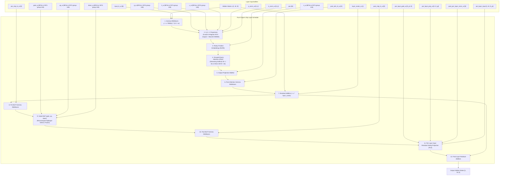

# Gemma 4 (E2B / E4B / 31B INT4) Model Architecture Specification & UOp Graph

- **Status**: **Fully Supported on Consumer Hardware (`gfx1100` / AMD Radeon RX 7900 XTX 24 GB)**
- **Model Variants**:
  - **Gemma 4 E2B**: `BF16` (2.3B parameters, 22 layers, 4.6 GB VRAM)
  - **Gemma 4 E4B**: `BF16` (4.3B parameters, 34 layers, 8.6 GB VRAM)
  - **Gemma 4 31B**: `W4A16 INT4` group-128 (31B parameters, 60 layers, **16.95 GB VRAM**)
- **Clojure Sources**:
  - High-level Declarative Logic AST: [`src/einsum/models/gemma.clj`](../../src/einsum/models/gemma.clj)
  - Pure-Clojure UOp Kernels: [`src/einsum/models/gemma4/kernels.clj`](../../src/einsum/models/gemma4/kernels.clj)
  - Native Device Runtime: [`src/einsum/models/gemma4/runtime.clj`](../../src/einsum/models/gemma4/runtime.clj)
- **CLI Runner**: [`tools/gemma4.sh`](../../tools/gemma4.sh)
- **Test Suite**: [`test/einsum/models/gemma4_test.clj`](../../test/einsum/models/gemma4_test.clj) & [`test/einsum/uop/golden_test.clj`](../../test/einsum/uop/golden_test.clj)

---

## 1. Visual Execution Graph (Declarative Logic $\to$ Pure-Clojure UOp Schedule)

The following Mermaid diagram represents the pure-Clojure UOp execution graph compiled from `gemma4-layer-ast` in `clj-einsum`:



---

## 2. Hyperparameter Specifications

| Hyperparameter | Gemma 4 E2B | Gemma 4 E4B | Gemma 4 31B INT4 |
| :--- | :--- | :--- | :--- |
| **Precision** | `BF16` | `BF16` | **`W4A16 INT4` (group-128)** |
| **Parameters** | 2.3B | 4.3B | **30.7B** |
| **Total VRAM Footprint** | **4.6 GB** | **8.6 GB** | **16.95 GB** (Fits in 24 GB) |
| **Hidden Dimension ($d_{model}$)** | 1536 | 2560 | 5120 |
| **Layers ($N_{layers}$)** | 22 | 34 | 60 |
| **Query Heads ($H_q$)** | 8 | 10 | 32 |
| **KV Heads ($H_{kv}$)** | 1 | 2 | 8 |
| **Head Dimension ($d_k$)** | 256 | 256 | 128 |
| **Intermediate Size** | 6144 | 10240 | 16384 |
| **Per-Layer Gating Dim ($D_{pl}$)**| 256 | 256 | 512 |
| **Vocabulary Size** | 256,000 | 256,000 | 256,000 |

---

## 3. Key UOp Optimizations for Gemma 4

1. **Fused In-Register INT4 Dequantization (31B)**:
   - Quantized weights are stored in global VRAM as packed 4-bit nibbles with group-128 scales.
   - Unpacking arithmetic (nibble isolation, zero-point subtraction, scale multiplication) executes inside GPU thread registers directly before Wave32 WMMA tensor operations.
   - Eliminates 30+ GB of intermediate FP32 weight allocations in VRAM.
2. **Reconvergent Epilogue GeGLU Fusion**:
   - The gated activation $y = \text{gate}(x) \cdot \text{gelu}(\text{up}(x))$ is folded directly into the matrix multiplication reduction loop via `find-reconvergent-epilogue-subchain`.
   - Avoids writing intermediate projection tensors back to global memory.
3. **Static-Shape Ping-Pong KV Cache**:
   - Pre-allocates fixed-shape KV buffers within the session arena (`einsum.runtime.arena`).
   - KV states alternate between dual ping-pong buffers per token, completely eliminating GC allocations and graph recompilation.

---

## 4. Interactive CLI Generation Commands

All Gemma 4 inference runs via the unified [`tools/gemma4.sh`](../../tools/gemma4.sh) wrapper:

```bash
# Gemma 4 E2B (BF16, 2.3B) on ROCm
./tools/gemma4.sh --backend uop-rocm --model .models/gemma-4-E2B-it --prompt "Explain monads in Clojure"

# Gemma 4 E4B (BF16, 4.3B) on ROCm
./tools/gemma4.sh --backend uop-rocm --model .models/gemma-4-E4B-it --prompt "Explain monads in Clojure"

# Gemma 4 31B (W4A16 INT4, 16.95 GB VRAM) on ROCm
./tools/gemma4.sh --backend uop-rocm --model .models/gemma-4-31b-it-int4 --prompt "Explain monads in Clojure"

# Autonomous Coding Agent Loop
./tools/gemma4.sh agent --backend uop-rocm --model .models/gemma-4-E2B-it --prompt "Inspect src/ and list files"
```
